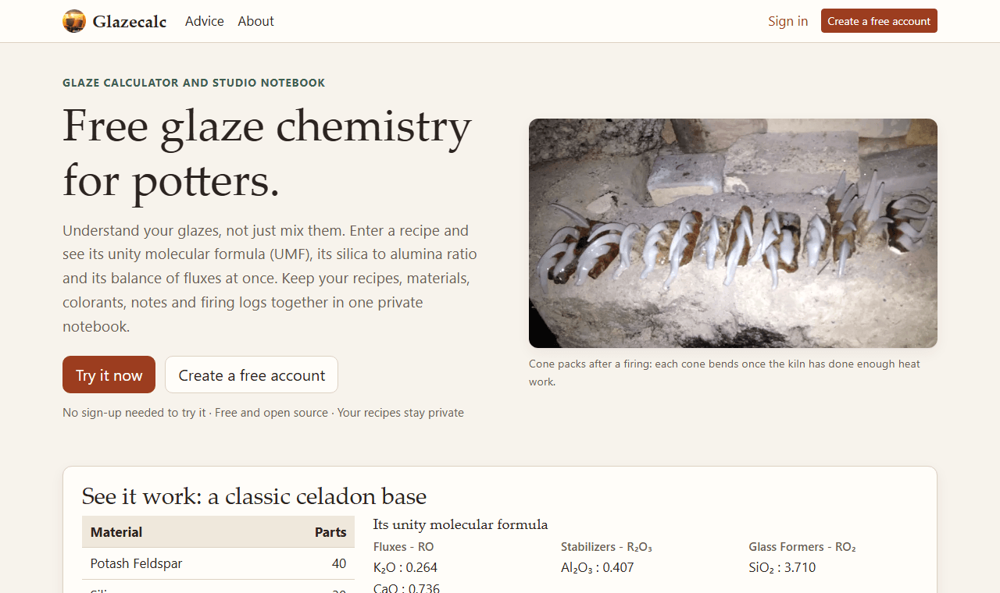
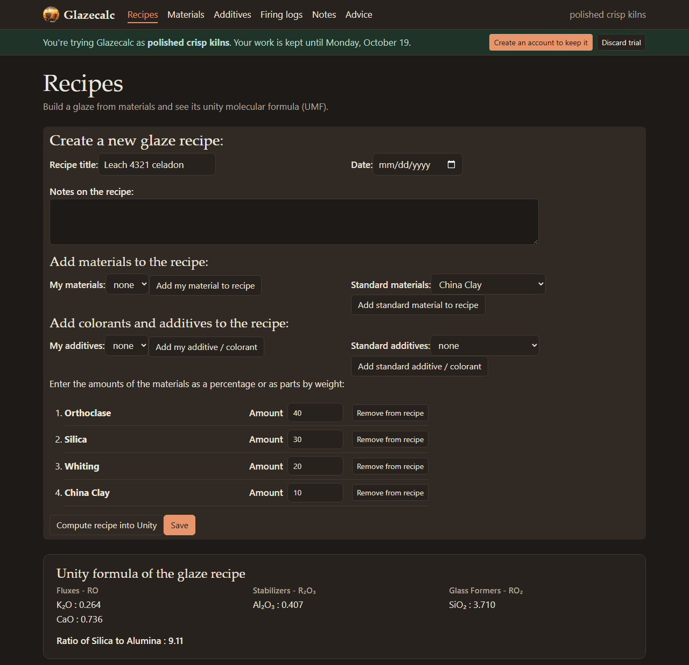
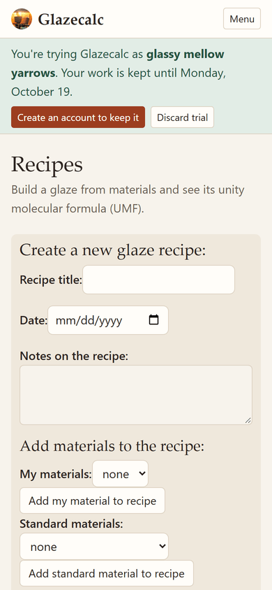
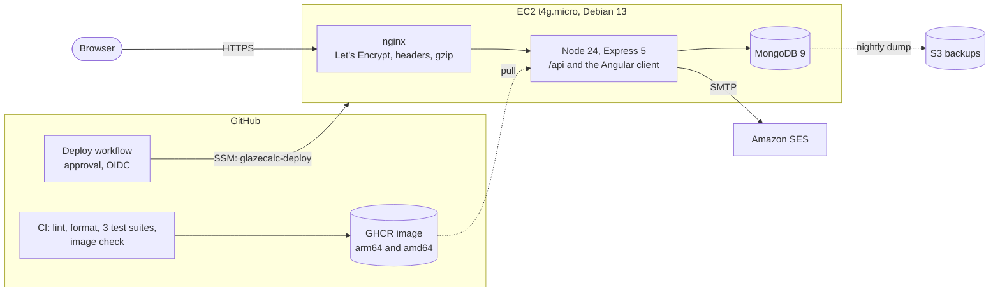

# Glazecalc

**Free glaze chemistry for potters.** Enter a glaze recipe and see its unity molecular formula
(UMF): the fluxes, alumina and silica it becomes in the kiln, and their ratio. Keep your recipes,
materials, colorants, firing logs and notes together in one private notebook.

**[glazecalcapp.com](https://glazecalcapp.com)**: try it without an account. A non-profit project by
Aaron Filson, in 57 languages, and usable from AI assistants through its MCP server.

<table>
  <tr>
    <td width="66%"></td>
    <td></td>
  </tr>
</table>

## At a glance

For anyone reading the code; the [highlights](#highlights) below give the details.

- **Stack:** Angular 22 (standalone components, signals, zoneless), TypeScript on Node 24 with Express 5 and
  Mongoose 9, MongoDB 9, Docker, and AWS (EC2, SSM, SES, S3, CloudWatch).
- **Tested in CI on every pull request:** over 1,750 server tests (98% of statements), over 1,150 Angular unit tests
  (91% of statements) and over 450 Playwright browser tests, with axe checks against WCAG 2.2 AA. Also the official
  MCP conformance suite, CodeQL on the code and the workflows, and Lighthouse on desktop: performance 99;
  accessibility, best practices and SEO 100. CI checks these numbers too.
- **Security:** sign-in with OAuth 2.0 and OpenID Connect (Google, GitHub, Microsoft) or a password; MFA with WebAuthn
  passkeys, TOTP and recovery codes; JWTs in httpOnly cookies with CSRF protection; a layered content security
  policy and a Permissions-Policy, graded A+ by Mozilla's HTTP Observatory; keyless CI/CD with no stored AWS keys,
  and images published with an SBOM and signed SLSA build provenance.
- **AI assistants:** an MCP server in the official MCP Registry, with its own OAuth authorization server: apps reach
  a person's records only with their consent, and, if the person chooses, an app's changes wait for their approval.
- **Reach on a small budget:** 57 languages, right to left (RTL) included; about 11,500 public pages prerendered (SSG)
  and hydrated; offline once visited (PWA); one $13-a-month Graviton instance, with automatic rollback.
- **How it is built:** with Claude Code as a directed coding agent. Decisions are written down first, in
  [decision records](docs/adr/README.md); every change goes through the checks above; production deploys wait for
  approval. The [case study](docs/case-study.md) tells how the 2017 app was revived.

## Highlights

The details, with the decisions behind them:

- **A 2017 AngularJS app rebuilt** as Angular 22 (standalone components, signals, zoneless with no zone.js,
  strict templates) and a TypeScript server on Express 5, Mongoose 9 and Node 24, which runs the
  `.ts` files directly with no build step ([ADR 8](docs/adr/0008-typescript-server-without-a-build.md)),
  and put back online. The
  [case study](docs/case-study.md) tells how.
- **Tested at three levels, in CI on every pull request and push to master:** over 1,750 server tests (98% of
  statements) run against the app in-process; over 1,150 Angular unit tests (91% of statements); over 450 Playwright
  browser tests, including [axe](https://github.com/dequelabs/axe-core) accessibility checks against WCAG 2.2 AA of
  every page in light and dark mode, every page in a pseudo-locale to find text not marked for translation, and
  every page in each language at a phone's width. CodeQL scans the code and the workflows
  ([its settings](.github/codeql/codeql-config.yml)), and CI checks the numbers in this README against each run
  ([scripts/readme-numbers.mjs](scripts/readme-numbers.mjs)).
- **One glaze chemistry library** for the browser and the tests, checked against values worked
  out by hand ([ADR 4](docs/adr/0004-shared-chemistry.md)).
- **Keyless CI/CD with approval:** GitHub Actions gets short-lived AWS credentials through
  OIDC, for a role that can only run one SSM command document on this app's instance. There is
  no SSH, there are no stored AWS keys, and a failed health check means an automatic rollback
  ([ADR 2](docs/adr/0002-keyless-deploys.md)). After every deploy, and daily, [live checks](.github/workflows/live-checks.yml)
  test the site from outside (synthetic monitoring): its health and security headers, each language's home page, the
  pages in a browser with no CSP violation or script error, and the MCP endpoint against the protocol.
- **A supply chain you can check:** every action pinned to a commit, Dependabot, CodeQL, and the production image
  published with an SBOM and SLSA build provenance, signed through GitHub
  (`gh attestation verify oci://ghcr.io/aaronfilson/glazecalc:latest --owner AaronFilson`). OpenSSF Scorecard
  rates the repository weekly ([.github/workflows/scorecard.yml](.github/workflows/scorecard.yml)).
- **Production for about $13 a month:** one Graviton EC2 instance with Docker Compose, nginx and
  Let's Encrypt, a layered content security policy (nginx's, a nonce per reply, and script hashes with
  'strict-dynamic') with subresource integrity and a Permissions-Policy, graded A+ (120) by
  [Mozilla's HTTP Observatory](https://developer.mozilla.org/en-US/observatory/analyze?host=glazecalcapp.com),
  structured JSON logs, nightly backups to S3,
  snapshots and CloudWatch alarms ([ADR 1](docs/adr/0001-one-ec2-instance.md),
  [ADR 3](docs/adr/0003-nginx-and-lets-encrypt.md)).
- **Careful accounts:** bcrypt; HS256 JWTs with a version, so changing the password signs out
  every device, kept in an httpOnly, SameSite=Strict cookie with a cross-site request check (CSRF protection);
  hashed single-use reset links sent through Amazon SES with DKIM, SPF and DMARC;
  rate limits; ownership checks on every query; the current password to change the email or
  delete the account ([ADR 5](docs/adr/0005-sign-in-tokens.md),
  [ADR 6](docs/adr/0006-email-through-ses-smtp.md)).
- **Two-step sign-in (MFA) and outside providers:** WebAuthn passkeys, authenticator apps (TOTP) and recovery codes
  ([ADR 14](docs/adr/0014-two-step-sign-in.md)); Google and GitHub (OAuth 2.0 and OpenID Connect) linked by the
  provider's id, never silently by email ([ADR 15](docs/adr/0015-provider-sign-in.md)); Microsoft by tenant and
  subject ([ADR 23](docs/adr/0023-microsoft-sign-in.md)).
- **Privacy, written down:** the records GDPR and the UK GDPR ask of a small service, kept with the code: a
  [record of processing](docs/processing-record.md) (Article 30), a [breach plan](docs/breach-plan.md) (Articles 33
  and 34), and how [data-protection requests](docs/data-requests.md) are answered (Articles 12 to 22).
- **AI assistants as first-class clients:** a stateless MCP endpoint sharing the app's recipe tools
  ([ADR 17](docs/adr/0017-mcp-server.md), [ADR 19](docs/adr/0019-shared-recipe-tools.md)), listed in the
  [MCP Registry](https://registry.modelcontextprotocol.io/v0/servers?search=com.glazecalcapp/glazecalc) and checked
  in CI against the official conformance suite; Glazecalc's own OAuth authorization server
  ([ADR 24](docs/adr/0024-authorization-server.md)); and changes from an app that wait for the person's yes, when
  they choose ([ADR 25](docs/adr/0025-confirm-before-changes.md)).
- **A translation pipeline (i18n) for 57 languages, right to left (RTL) included:** Transloco with ICU messages and the language in the URL
  ([ADR 13](docs/adr/0013-translations.md)); per-language glossaries sourced from suppliers'
  catalogues, staged reviews, blind back-translation of the safety text, and a plain notice for
  languages AI translates less well ([process](docs/translations/process)); `npm run check:i18n`
  guards placeholders, plurals and stale English in CI.
- **Works offline once visited, as a PWA:** Angular's service worker keeps the app, and the app keeps the
  reader's language and the guides in Cache Storage ([ADR 28](docs/adr/0028-service-worker.md)).
- **Public pages prerendered at build (SSG)** in every language and hydrated in place (Angular hydration), with hreflang and
  a sitemap per language under one index, about 11,457 pages, each reply compressed in Node with a
  fresh nonce ([ADR 16](docs/adr/0016-prerendered-public-pages.md)).
- **Trials as real accounts:** a generated name, a placeholder email on the reserved `.invalid`
  domain so every email stays unique, conversion to an account in place (or into an existing
  account at sign-in), limits against abuse,
  and an hourly cleanup ([ADR 7](docs/adr/0007-trials-as-real-accounts.md)).
- **Lighthouse in CI, on a production build (desktop):** performance 99; accessibility, best practices and SEO 100;
  no layout shift. Four public pages, the median of three runs each; CI fails below the limits in
  [lighthouserc.json](scripts/lighthouse/lighthouserc.json), and `npm run lighthouse` measures the same here.

## What it does

Every feature, as a potter meets it.

Recipes and their chemistry, sharing, guides, regions and languages, and the rest

- **Recipe to unity formula, as you type.** Build a glaze from your own materials or the
  standard ones and watch its oxides in unity, grouped as fluxes, stabilizers and glass formers,
  with the silica to alumina ratio. That is how glaze chemists compare recipes, fix faults and
  substitute materials. Change the scale to percent, to the smallest whole parts, or to a batch
  in grams or in pounds (each shown in pounds and ounces), with colorants as a percent of the
  base, in parts or in grams; save a recipe and
  keep working on it, or open a saved one to change it.
- **Compare two recipes side by side,** oxide by oxide and by calculated thermal expansion, and try an old recipe with the modern
  materials that replace its discontinued ones (Custer Spar to G-200 EU), compared with the
  original. Where a swap is not like for like, it works the amounts out again, changing as few as
  it can, from materials sold in your region or any you add, and says what each one does and what
  to watch for past a recommended limit.
- **Match with what I have:** make a recipe again from only the materials on hand, a list kept
  with your account.
- **Analysis and limits:** the unity formula set against Hesselberth & Roy's stable glaze limits
  or Glazecalc's own, for the firing saved with the recipe, and a **Stull chart** of silica
  against alumina with its matte, semi-matte and bright regions.
- **Specific gravity and water:** weigh a measured volume of the glaze to find its SG, then the
  water that brings the bucket to the SG you want, or the water for a new batch.
- **Paste in recipes** from a website, a spreadsheet or your notes: see how each line was read
  and which material it was taken for before anything is saved.
- **Blends for test tiles:** two, three or four of your recipes blended into numbered tiles,
  with what to weigh for each and the chemistry of each tile.
- **Cost per batch** from the prices you pay, kept private with your account in one currency,
  and a **mix ticket** to print for the glaze room, with the batch number, the target SG and the
  materials' hazards (prices left off unless you choose).
- **Share a recipe** with a read-only link that anyone can open without an account, with its
  unity formula and **how it is worked out**, step by step; stop sharing at any time.
- **Sign in with Google, GitHub or Microsoft,** or with a password, two-step sign-in or a passkey.
- **Use it from your AI assistant:** Claude, ChatGPT, GitHub Copilot, Cursor, Gemini and others
  can use the calculations through the Model Context Protocol (MCP) server at `/mcp`, and your own
  records once you connect them: apps sign in to Glazecalc's own OAuth server and you say yes
  (read only unless you also allow changes), or you make an access token for them. **Connected
  apps** shows what each one did, puts back what it moved to the Trash and revokes it; the
  Assistants page says how to connect one.
- **Guides for new potters,** sourced: glazing from first principles with a glossary, how to make
  a glaze, safe mixing and ventilation, pottery at home with children and pets, and firing a
  basic kiln with cones, kiln sitters and manual switches; and, in English, a companion to John
  Britt's free online Glaze Course that links his videos unit by unit with exercises to try; and,
  in English and Japanese, a six-session pack for teaching glaze calculation.
- **Famous glazes,** each a public page with its traditional recipe or historic analysis and a
  version from the materials sold where you live (İznik first, as history, with a lead-free
  version not yet test-fired).
- **Specific gravity and water,** with the dry materials' SG estimated from the recipe (or typed,
  or measured as the making-a-glaze guide shows).
- **Lead off unless you choose it,** and old lead glazes rebuilt without it: Replace lead keeps
  the glaze's silica and alumina and gives lead's work to boron and other fluxes, on a lead-free
  base frit sold in your region with up to four other materials chosen for it, or keeps the
  colour on a lead-free base.
- **Print it for the glaze room:** the whole recipe with its unity formula and analysis, or just
  a batch list to tick off while weighing, with a running total for weighing into one bucket. One
  page on Letter or A4; weights in grams, or in pounds and ounces as set in your account.
- **Your region and your numbers:** where you work sets numbers and dates as you write them
  (12,5 or 12.5 typed either way), °C or °F, Orton cones, SK cones (JIS R 8101) or firing by temperature, the standard
  materials sold there, and in the guides: who to call in an emergency for 72 countries, and for
  41 of them shops that sell glaze materials, the closest materials sold there to those a recipe
  names and the workplace limit for silica dust, with food-contact limits for glazed ware for 42;
  each checked on an official or the shop's own page.
- **Translated into 57 languages:** an official language of every country of the EU (Bulgarian, Croatian, Czech, Danish, Dutch, English, Estonian, Finnish, French, German, Greek, Hungarian, Irish, Italian, Latvian, Lithuanian, Maltese, Polish, Portuguese, Romanian, Slovak, Slovenian, Spanish, and Swedish), Japanese, Turkish, Traditional Chinese, Korean, Simplified Chinese, Thai, Vietnamese, Indonesian, Arabic and Urdu (right to left), Hindi, Bengali, Tamil, Marathi, Kannada, Telugu, Gujarati, Malayalam, Punjabi, Odia, Nepali, Sinhala, Latin American Spanish, Brazilian Portuguese, Swahili, Amharic, Afrikaans, Hausa, Yoruba, Zulu, Igbo, Somali and Quechua, each at its own addresses (`/de/recipe`).

  Translated by AI with a glossary per language from suppliers' catalogues, reviewed, and the safety text checked by translating it back; every translated page says so and links to a form to suggest a better wording.

  Every piece of text is a message (Transloco with ICU plurals), and the guides are Markdown per language ([how translations are made](docs/translations/README.md)).

- **Your own colors:** light, dark or as the device is set, and six palettes named for glazes,
  each readable in both.
- **A standard library of 182 materials and 37 colorants and additives,** from manufacturers'
  data sheets (and, for ashes and historical native materials, published research), for the US, UK, EU, Australia, New Zealand and the other regions, each with its source and other names, and hazards where the data sheet gives them, each with its own public page in every language. Discontinued materials
  stay for old recipes, each pointing to its modern replacement. Count colorants in the unity
  formula or leave them out, to compare with other calculators.
- **Your own materials,** from a chemical formula or a supplier's analysis, and colorants and
  opacifiers on top of a base glaze.
- **A studio notebook:** firing logs (times, temperatures, cones), notes, and plain-language
  advice on mixing, glazing and firing.
- **Try it now:** the whole app works as a trial with a generated name such as "speckled quiet
  kilns". Creating an account keeps everything; trials are removed after 14 days.
- Light and dark mode, from phone to desktop. Free and open source.

## How it fits together

The browser talks to one origin: nginx terminates HTTPS and passes everything to a single Node
process, which serves the JSON API under `/api` and the built Angular client for every other path.
A deploy runs `deploy.sh` on the instance through SSM: it pulls the new image, starts it, and goes
back to the previous one if the health check fails.

| Part           | Built with                                                                                              |
| -------------- | ------------------------------------------------------------------------------------------------------- |
| Client         | Angular 22, TypeScript (strict), Transloco with ICU messages, Bootstrap 5 with a custom palette, Vitest |
| Server         | TypeScript run directly by Node.js 24, Express 5, Mongoose 9, JWT, bcrypt, Mocha                        |
| Data           | MongoDB 9                                                                                               |
| Infrastructure | AWS (EC2, SSM, SES, S3, CloudWatch, IAM with OIDC), Docker Compose, nginx, certbot                      |
| Delivery       | GitHub Actions, GHCR, Playwright with axe, ESLint, Prettier, Dependabot                                 |

## Run it locally

You need [Node.js](https://nodejs.org/) 24 (24.15 or later) with npm 11, and
[MongoDB Community Server](https://www.mongodb.com/try/download/community) 9.0 (4.4 or later
works).

    git clone https://github.com/AaronFilson/glazecalc.git
    cd glazecalc
    npm install
    npm run db                        # MongoDB on ./db, in a second terminal; leave it running
    npm run seed                      # standard materials, additives and advice
    npm run dev                       # then open http://localhost:3000

Settings such as `APP_SECRET` and `MONGODB_URI` can go in a `.env` file (copy `.env.example`,
which describes each one); the scripts load it with Node's built-in `--env-file` support. Outside
production, emails (such as password reset links) are printed to the console.

On macOS before 14, Sass's native compiler cannot run, and the Angular build and tests stop at
"Building...". Set `NG_BUILD_SASS_EMBEDDED=0` in your shell (in `~/.zshrc`, say), not in `.env`, which
`ng` does not read: the build then uses Sass's JavaScript compiler, and so does the server's Bootstrap test.

All the tools, with install links and version checks

| Tool                                                                                                                  | Needed for                           | Install                                                                             | Check the version           |
| --------------------------------------------------------------------------------------------------------------------- | ------------------------------------ | ----------------------------------------------------------------------------------- | --------------------------- |
| [Git](https://git-scm.com/)                                                                                           | Cloning the repository               | [Downloads](https://git-scm.com/downloads)                                          | `git --version`             |
| [Node.js](https://nodejs.org/) 24 LTS (24.15 or later)                                                                | Building and running the app         | [Download Node.js](https://nodejs.org/en/download)                                  | `node --version`            |
| [npm](https://www.npmjs.com/) 11 (comes with Node.js 24)                                                              | Installing packages, running scripts | [Installing npm](https://docs.npmjs.com/downloading-and-installing-node-js-and-npm) | `npm --version`             |
| [MongoDB Community Server](https://www.mongodb.com/products/self-managed/community-edition) 9.0 (4.4 or later works)  | The database                         | [Download MongoDB](https://www.mongodb.com/try/download/community)                  | `mongod --version`          |
| A modern web browser, such as [Firefox](https://www.mozilla.org/firefox/) or [Chrome](https://www.google.com/chrome/) | Using the app                        | [Firefox download](https://www.mozilla.org/firefox/new/)                            | Help → About in the browser |

Optional, depending on what you do:

| Tool                                                                                                             | Needed for                                | Install                                                                                                                                                  | Check the version                               |
| ---------------------------------------------------------------------------------------------------------------- | ----------------------------------------- | -------------------------------------------------------------------------------------------------------------------------------------------------------- | ----------------------------------------------- |
| [nvm-windows](https://github.com/coreybutler/nvm-windows) or [nvm](https://github.com/nvm-sh/nvm) (macOS, Linux) | Switching between Node.js versions        | [nvm-windows releases](https://github.com/coreybutler/nvm-windows/releases), [nvm install script](https://github.com/nvm-sh/nvm#installing-and-updating) | `nvm version` (Windows), `nvm --version`        |
| [MongoDB Shell (mongosh)](https://www.mongodb.com/docs/mongodb-shell/)                                           | Looking at the database by hand           | [Download mongosh](https://www.mongodb.com/try/download/shell)                                                                                           | `mongosh --version`                             |
| [Docker Engine](https://docs.docker.com/engine/) with [Docker Compose](https://docs.docker.com/compose/)         | Running the app and MongoDB in containers | [Install Docker Engine](https://docs.docker.com/engine/install/)                                                                                         | `docker --version` and `docker compose version` |
| [WSL](https://learn.microsoft.com/windows/wsl/) 2.1.5 or later (Windows only)                                    | Running Docker inside Linux on Windows    | [Install WSL](https://learn.microsoft.com/windows/wsl/install)                                                                                           | `wsl --version`                                 |
| [Playwright](https://playwright.dev/) Chromium                                                                   | The browser tests                         | [Install browsers](https://playwright.dev/docs/browsers#install-browsers): `npx playwright install chromium`                                             | `npx playwright --version`                      |

The Angular CLI, TypeScript, ESLint and the test runners are installed into the project by
`npm install`, so they need no separate install; `npx ng version` shows the Angular versions.

## Scripts

    npm run dev      Angular dev server on port 3000 with live reload; it forwards /api to the
                     API server on port 4000, which restarts when server code changes
    npm run build    production build of the client into dist/glazecalc/browser, then renders the
                     public pages in every language to dist/glazecalc/prerendered (docs/seo-plan.md)
    npm start        builds, then runs one server on port 3000 (PORT) with the app and its API
    npm run seed     loads the standard materials, additives and advice into MONGODB_URI
    npm run lint     checks the code with ESLint
    npm run typecheck  checks the server's TypeScript (Node runs it without compiling)
    npm run format   formats files with Prettier (npm run format -- .)

`npm run seed` replaces standard records with the same id, so it is safe to run again after the
data files change, and it leaves users' own entries alone. All scripts work in any shell,
including PowerShell and cmd.

## Tests

| Command                  | What it runs                                                                                                                                                                                                                                                                                                                                                                                                   |
| ------------------------ | -------------------------------------------------------------------------------------------------------------------------------------------------------------------------------------------------------------------------------------------------------------------------------------------------------------------------------------------------------------------------------------------------------------- |
| `npm test`               | Server and chemistry tests (Mocha), the files in parallel (a worker for each core but one; `--jobs` sets it). Each worker serves the app inside its process on a free port with a database of its own (`glazecalc_test_w0`, `_w1`, …, emptied before each file and dropped after); only `mongod` must be running.                                                                                              |
| `npm run test:client`    | Angular unit tests (Vitest), with no server or database.                                                                                                                                                                                                                                                                                                                                                       |
| `npm run test:e2e`       | Browser and accessibility tests (Playwright and axe), in parallel workers (half the cores; `E2E_WORKERS` sets how many) against one server. They build the app when `dist/` is older than its sources (`E2E_BUILD=always` or `never` overrides), run it on port 3100 (`E2E_PORT`) with a `glazecalc_e2e` database (`E2E_MONGO_URI`) they reset, and need Chromium once: `npx playwright install chromium`.     |
| `npm run test:e2e:linux` | The browser tests on Linux in Docker, in the same Playwright image CI runs them in, so a layout that passes here passes there. It tests the working tree, uncommitted changes included, and copies what failed to `test-results-linux/`. On Windows it runs through WSL, which needs Docker inside it.                                                                                                         |
| `npm run test:e2e:both`  | The browser tests here and on Linux at the same time, each with a quarter of the cores (`E2E_WORKERS` sets each run's workers), with each line marked with the run it came from. The two share nothing, so it takes about as long as the slower one.                                                                                                                                                           |
| `npm run check:i18n`     | The messages: every key the app uses has its English and every English is used, translations keep the English's placeholders, tags and plural forms, and the English written from code is current ([how to write text](docs/translating.md)).                                                                                                                                                                  |
| `npm run i18n:sources`   | Writes the English of the messages kept in code and data (the server's, the chemistry's, the standard records', who to call, the region data) for translators, and takes out every translation made from English that has changed since ([docs/translating.md](docs/translating.md)). It refuses while translations have uncommitted changes (`--force` overrides); `-- --dry-run` shows what it would change. |
| `npm run test:all`       | The server, Angular and browser tests, on this machine.                                                                                                                                                                                                                                                                                                                                                        |
| `npm run test:all:linux` | The server and Angular tests, then the browser tests on Linux. Run it before pushing anything that changes layout or printing.                                                                                                                                                                                                                                                                                 |
| `npm run lighthouse`     | Lighthouse on a production build, as CI runs it: four public pages on the desktop setting, three runs each, against the limits in `scripts/lighthouse/lighthouserc.json`. It builds when `dist/` is out of date, runs the app as production on port 3200 (`LIGHTHOUSE_PORT`) with a `glazecalc_lighthouse` database, and needs Chrome. The reports go to `lighthouse-results/`.                                |

`npm run test:coverage` and `npm run test:client:coverage` add coverage reports, and
`npx playwright show-report` opens the browser test results. GitHub Actions runs lint, the format
check, an npm audit, the build and all three suites on pushes to master and on pull requests,
against a MongoDB 9 service container, and builds and checks the Docker image
(`.github/workflows/ci.yml`). The jobs run side by side, and the browser tests are split across
three runners (`--shard`), whose reports are merged into one (the `playwright-report` artifact).
The server and Angular suites run with coverage, a Lighthouse job measures a production build, and
a last job checks the numbers this README gives against the run (`scripts/readme-numbers.mjs`): one
that is no longer true fails the run, and one that has fallen well behind gets a warning. CodeQL scans
the code and the workflows in a workflow of its own (`.github/workflows/codeql.yml`).

## Project structure

    client/           Angular 22 app (standalone components, signals, no zone.js)
      app/core/         API access, sign-in and trials, route guards, data models
      app/i18n/         languages: loading messages, the language in the address, the AI notice
      app/pages/        one folder per screen: landing, recipe, material, additive, firing, ...
      app/shared/       page header, messages, option lists
      public/           icons, images, manifest and robots.txt, copied into the build
      public/i18n/      the messages in each language, and the guides in Markdown
      i18n-fingerprints/  the English each translation was made from
      styles.scss       the palette and dark mode, on top of Bootstrap 5
    lib/chemistry/    glaze chemistry: molar masses, material analyses, the unity formula
    lib/recipe/       the recipe tools the app, the server and the MCP tools share: amounts,
                      analysis, limits, checks, substitutions, blends (ADR 19)
    lib/cones/        pyrometric cones (Orton, SK) and a recipe's firing
    lib/regions/      the regions and languages, and each country's facts for the guides:
                      who to call, shops, silica limits, food-contact rules
    lib/pages.js      the pages worth finding in a search (sitemap, server, prerender)
    lib/mfa.js        the numbers two-step sign-in's server and app share
    server/           the API server, in TypeScript that Node runs as it is (no build step)
      main.ts           starts it: connects to MongoDB, listens, shuts down cleanly
      app.ts            the Express app: the API under /api, the built client for the rest,
                        and the sitemap (/sitemap.xml), written for each language
      routes/           accounts, password reset, trials, and records.ts: the seven kinds of
                        record a user keeps, served by one route factory
      lib/              sign-in tokens, the record routes, trial limits and cleanup, email, logging
      mcp/              the MCP server for AI assistants (/mcp): its tools, prompts and guides
      models/           Mongoose schemas
      test/             server and chemistry tests (Mocha)
    e2e/              browser and accessibility tests (Playwright, axe)
    data/             the standard materials, additives and advice, loaded by npm run seed
    scripts/          the dev runner (npm run dev), the seed script, the messages check and
                      sources (npm run check:i18n, i18n:sources), the browser tests on Linux
                      (npm run test:e2e:linux), Lighthouse (npm run lighthouse), the README's
                      numbers check, and one that adds records to the library
    Dockerfile, compose.yaml
                      the production image, and the app plus MongoDB in containers
    deploy/           production on EC2: Compose file, nginx, cloud-init, deploy and backup
                      scripts, AWS policies and setup commands
    docs/             decision records (adr/), the case study, the translation plan and guides
                      (translating.md, translations/), setup notes
    .github/          CI, CodeQL, image publishing and deploy workflows, issue forms, Dependabot

## Docker and deployment

The Dockerfile builds a production image: Node 24 on Debian slim, running as a non-root user, with
a health check on `/api/health` that also checks the database. `compose.yaml` runs it with
MongoDB 9, keeping the data in a named volume:

    APP_SECRET=<long random string> docker compose up -d --build
    docker compose run --rm app node scripts/seed-standard.js    # standard data, once
    docker compose logs -f app

The app is published on 127.0.0.1:3000 only; put a reverse proxy in front for public access,
because ports Docker publishes bypass ufw. Production on AWS is described step by step in
[deploy/README.md](deploy/README.md) and [deploy/aws/README.md](deploy/aws/README.md). On Windows,
Docker Engine runs inside WSL: [docs/wsl-local-deploy-debian.md](docs/wsl-local-deploy-debian.md)
has notes from setting it up in WSL Debian.

When the app is reachable by other people, set `APP_SECRET` to a long random value (production
requires it; changing it signs everyone out), set `MAIL_TRANSPORT` and `SMTP_URL` so password
reset emails can go out, and set `SITE_URL` (formerly `APP_URL`) to the address people open the app at, which the links
in those emails use. Put them in the environment or in `.env`; `compose.yaml` passes them to the
app ([.env.example](.env.example) describes each one). Sign-in, sign-up, trials and password reset
are rate limited per client address; behind a reverse proxy the app trusts one hop of
`X-Forwarded-For` for that address.

## More

- [Decision records](docs/adr/README.md): why it is built the way it is.
- [How translations are made](docs/translations/README.md) and [how to write text](docs/translating.md).
- [Contributing](CONTRIBUTING.md) and [reporting a security problem](SECURITY.md).
- [Changelog](CHANGELOG.md).
- [Case study](docs/case-study.md): reviving a 2017 app.
- Found a problem or have an idea? [Open an issue](https://github.com/AaronFilson/glazecalc/issues).

Glazecalc is open source under the [MIT License](LICENSE).
